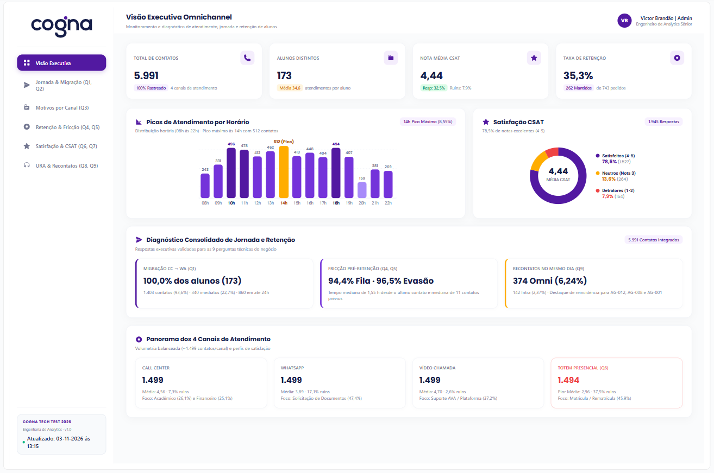
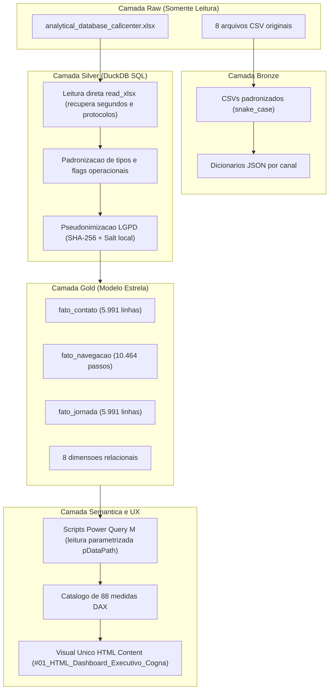

# Cogna Educação — Teste técnico de analista de dados sênior

Projeto de engenharia de dados e analytics desenvolvido para o teste técnico da Cogna Educação. A solução consolida e analisa atendimentos em quatro canais operacionais (Call Center, WhatsApp, Vídeo Chamada e Totem de autoatendimento), aplica padronização de dados, limpeza e modelagem dimensional em DuckDB SQL, responde às nove perguntas obrigatórias do case e integra a camada analítica com o Power BI Desktop via scripts M enxutos, catálogo de 88 medidas DAX e dashboard executivo desenvolvido na arquitetura de visual único HTML Content.

---

## 1. Resumo executivo e síntese das respostas de negócio

Abaixo estão consolidadas as conclusões analíticas e respostas finais para as nove perguntas de negócio levantadas pelo case, reconciliadas com zero divergências entre DuckDB SQL e medidas DAX:

| Pergunta | Indicador principal | Resultado validado | Conclusão prática e impacto operacional |
| :--- | :--- | :---: | :--- |
| **Q1 (Call Center -> WhatsApp)** | % de migração posterior | **100,0%** (173 alunos) | Todos os 173 alunos do Call Center migraram posteriormente para o WhatsApp; 1.403 contatos (93,6%) migraram no total, sendo 340 imediatos (22,7%) e 860 em até 24h (57,4%). |
| **Q2 (Trinca CC -> WA -> Outro)** | Alunos na trinca consecutiva | **138 alunos** (251 ocorrências) | 138 alunos realizaram a sequência consecutiva Call Center -> WhatsApp -> outro canal (exceto WA); 104 foram para vídeo ou totem (145 casos); 173 na sequência ampla com intermediários. |
| **Q3 (Principais motivos por canal)** | Top 1 motivo por canal | **Documentos no WA (47,4%)** | WhatsApp é dominado por Solicitação de Documentos (47,4%); Call Center é dividido entre Dúvidas Acadêmicas (26,1%) e Financeiro (25,1%), com ressalva de 35,4% nulos na origem; Vídeo Chamada foca em Suporte AVA (37,2%); Totem foca em Matrícula/Rematrícula (45,9%). |
| **Q4 (Perfil da fila de retenção)** | % com contato prévio em outro canal | **94,44%** (255 de 270) | 94,44% dos contatos em fila de retenção e 96,49% dos que solicitaram cancelamento no Call Center passaram antes por outro canal; tempo mediano de 1,55 h desde o último contato prévio. |
| **Q5 (Comportamento pré-retenção)** | Volume prévio acumulado | **11 atendimentos** (mediana) | Alunos acumulam média de 13,41 e mediana de 11 contatos antes de atingir a retenção; alta fricção e reiteração de demandas antecedem a intenção de evasão. |
| **Q6 (Pior canal de atendimento)** | Pior nota média CSAT | **Totem (nota 2,96)** | Totem apresenta a pior nota média (2,96) e 37,5% de notas ruins (guardrail com n=24 e taxa de resposta de 1,60%); WhatsApp lidera em volume absoluto de detratores (84 notas ruins, 17,07%); Vídeo Chamada tem a melhor nota (4,58). |
| **Q7 (Perfil com notas ruins)** | Segmento mais impactado por notas ruins | **Calouros (68,1%)** | 182 contatos com nota ruim no total; concentração em alunos calouros (68,1%) e na modalidade Presencial Campus (13,24% ruins vs 8,42% EAD); polos Leste e Sul concentram o volume; pico no início da tarde em dias úteis. |
| **Q8 (Navegação na URA / DNA SOA)** | Influência dos nós financeiros na nota | **Nota 3,82** (19,4% ruins) | Nós de suporte financeiro e contestação de cobrança geram nota média inferior (3,82 e 19,4% de ruins) em comparação a nós de consulta simples (4,61 e 3,8% ruins). |
| **Q9 (Recontatos no mesmo dia)** | Taxa e volume de recontatos por agente | **6,24%** (374 recontatos) | Visão A Omnichannel registra 374 recontatos no mesmo dia (6,24%); Visão B Intracanal registra 142 (2,37%); líderes em volume e taxa são AG-012 (98,8%), AG-008 (200) e AG-001 (185). |

---

## 2. Painel executivo no Power BI



O dashboard analítico foi construído na arquitetura de visual único HTML Content, permitindo renderização fluida, visualização executiva consistente e aderência ao manual de identidade visual da Cogna Educação (Deep Navy, Electric Indigo, Verde Esmeralda e toques funcionais em Âmbar e Coral).

### 2.1. Estrutura das visões de negócio
O relatório está organizado em seis abas analíticas estruturadas para responder diretamente às perguntas de negócio do teste:
1. **Visão executiva**: síntese de volumetria (5.991 atendimentos e 173 alunos), distribuição horária com picos operacionais (10h, 14h e 18h), nota média CSAT (4,44) e distribuição de notas positivas (78,5%).
2. **Jornada Q1 e Q2**: análise da migração do Call Center para o WhatsApp (100% dos alunos migram posteriormente) e trinca consecutiva em canais distintos (138 alunos e 251 ocorrências).
3. **Motivos Q3**: ranking e participação percentual dos motivos de contato por canal (destaque para Solicitação de Documentos com 47,4% no WhatsApp e Dúvidas Acadêmicas com 26,1% no Call Center).
4. **Retenção Q4 e Q5**: perfil de fricção dos alunos antes de atingir a fila de retenção (94,44% com passagem prévia por outro canal) e curva de atendimentos acumulados (mediana de 11 contatos).
5. **Satisfação Q6 e Q7**: diagnóstico de detratores por canal (Totem com menor nota média e WhatsApp com maior número de notas ruins) e perfil do aluno afetado (calouros presencial campus).
6. **URA e recontatos Q8 e Q9**: impacto da árvore de navegação URA (DNA SOA) na satisfação final e recontatos no mesmo dia por agente operacional.

### 2.2. Guia de abertura e avaliação no Power BI Desktop

Para abrir e interagir com o dashboard no Power BI Desktop sem quebras visuais, siga o passo a passo:

1. **Abrir o arquivo do projeto:**
   - Abra o arquivo executivo `powerbi/dashboard/tech_test_cogna.pbix` no Power BI Desktop.
   - Alternativamente, desenvolvedores podem abrir o projeto desacoplado `powerbi/dashboard/tech_test_cogna.pbip`.
2. **Ajustar o parâmetro de dados (`pDataPath`):**
   - Caso os arquivos Parquet locais estejam em uma pasta diferente no seu computador, clique na barra de ferramentas superior em `Transformar Dados` -> `Editar Parâmetros`.
   - No parâmetro `pDataPath`, insira o caminho absoluto da pasta `data/gold` (exemplo: `C:\Users\...\cogna\data\gold`) ou da pasta de entrega `entrega\data\gold`.
   - Clique em `OK` e em seguida em `Fechar e Aplicar`.
3. **Renderização do visual HTML Content:**
   - O painel utiliza o visual oficial da comunidade `HTML Content` (certificado pela Microsoft no AppSource).
   - O visual consome a medida `#01_HTML_Dashboard_Executivo_Cogna` da tabela `_Medidas`, renderizando toda a interface de ponta a ponta.
   - Não há dependências de servidores ou CDNs externos: todo o CSS, tipografia, logos vetoriais da Cogna e ícones Heroicons estão embutidos diretamente no código DAX em SVG.

---

## 3. Arquitetura e linhagem dos dados

O fluxo de engenharia segue o padrão medallion local em quatro camadas, garantindo rastreabilidade, isolamento dos dados brutos e conformidade estrita com a LGPD:



Para a especificação completa de linhagem, transformações aplicadas e mapeamento de campos, consulte o documento [`docs/linhagem_dados.md`](docs/linhagem_dados.md).

---

## 4. Premissas de negócio e governança

- **Pseudonimização e privacidade (LGPD):** o campo original `identificador_aluno` é convertido em hash SHA-256 irreversível com salt local (`ALUNO_HASH_SALT` configurado via arquivo `.env`). Nomes pessoais de agentes e supervisores são substituídos por identificadores técnicos (`AG-001` a `AG-170`). Nenhum dado pessoal é exposto nas tabelas Gold ou versionado no Git.
- **Resolução de perdas na camada Silver:** os arquivos CSV exportados apresentavam truncamento dos segundos nos timestamps e notação científica em 16 protocolos longos. A camada Bronze espelha fielmente os CSVs recebidos, enquanto a camada Silver lê diretamente a planilha Excel original (`analytical_database_callcenter.xlsx`) via DuckDB SQL (`read_xlsx`), preservando segundos e números de protocolo íntegros.
- **Conceito de contato posterior:** considerado qualquer atendimento do mesmo aluno em timestamp estritamente posterior (`>`) no período de análise, acompanhado de janelas adicionais de 24 horas e 7 dias.
- **Identificação de retenção:** analisada de forma transparente sob duas óticas complementares: fila de atendimento contendo `"retenc"` (`eh_retencao_fila`) e assunto de tabulação contendo `"Atendimento de Retenção"` (`eh_assunto_retencao`).
- **Pesquisa de satisfação:** notas de 1 a 5 compõem respostas válidas (1 e 2 são classificadas como notas ruins). Valores zero ou em branco representam ausência de resposta (`respondeu_pesquisa = false`) e não entram no denominador da nota média. A taxa de resposta é sempre exibida junto à nota.
- **Recontatos no mesmo dia (Q9):** novo atendimento do mesmo aluno na mesma data calendário, atribuído ao agente que realizou o atendimento imediatamente anterior, avaliado nas visões Omnichannel e Intracanal.

---

## 5. Estrutura do repositório

```text
cogna/
├── .env.example              # Modelo de configuracao do salt de pseudonimizacao
├── .gitignore                # Regras de exclusao de dados, entrega local e caches
├── README.md                 # Documento principal com sintese de negocio e guia
├── pyproject.toml            # Configuracao do projeto, Ruff e Pytest
├── requirements.txt          # Dependencias fixadas do ambiente Python
├── data/                     # Dados locais (nao versionados no Git)
│   ├── raw/                  # Planilha original e CSVs em modo somente leitura
│   ├── bronze/               # CSVs com cabecalhos em snake_case
│   ├── dictionaries/         # Dicionarios de dados em JSON estruturado
│   ├── silver/               # Tabelas tratadas e tipadas em Parquet
│   └── gold/                 # Fatos e dimensoes em Parquet e CSV + relatorios JSON
├── docs/                     # Documentacao tecnica detalhada
│   ├── linhagem_dados.md             # Linhagem de ponta a ponta e rastreabilidade
│   ├── mapeamento_colunas.md         # De-para de campos e taxonomias por canal
│   ├── inconsistencias_dicionario.md # Diagnostico dos dicionarios originais
│   ├── qualidade_dados.md            # Profiling das bases e regras de limpeza Silver
│   ├── modelagem_e_analises.md       # Modelo estrela Gold e consultas analiticas
│   └── camada_semantica_powerbi.md   # Catalogo DAX e reconciliacao com SQL
├── powerbi/                  # Artefatos da camada analitica do Power BI
│   ├── m/                    # Scripts Power Query (.pq) parametrizados por pDataPath
│   ├── dax/                  # Catalogo de 88 medidas DAX organizadas por pastas
│   ├── dashboard/            # Artefatos executivos do Power BI Desktop
│   │   ├── tech_test_cogna.pbix               # Arquivo binario do Power BI Desktop
│   │   ├── tech_test_cogna.pbip               # Projeto desacoplado (Developer Mode)
│   │   ├── pre-visualizacao-dashboard_cogna.png # Captura em alta resolucao do painel
│   │   ├── 07_dashboard_html_content.dax      # Codigo DAX da medida do visual unico
│   │   ├── tech_test_cogna.Report/            # Definicoes de layout e paginas do relatorio
│   │   └── tech_test_cogna.SemanticModel/     # Modelo semantico e metadados TMDL
│   └── ux/                   # Design system, icones Heroicons e tema oficial JSON
├── sql/                      # Scripts em DuckDB SQL
│   ├── staging/              # Macros, leitura do XLSX, dominios e camada Silver
│   ├── model/                # Dimensoes e tabelas fato do modelo estrela Gold
│   └── analytics/            # Consultas analiticas das 9 perguntas (q01..q09)
├── src/                      # Pacote Python de engenharia, validacao e empacotamento
│   └── cogna_etl/
│       ├── __init__.py
│       ├── __main__.py       # Ponto de entrada CLI (inventory, silver, validate, package)
│       ├── inventory.py      # Inventario e reconciliacao inicial
│       ├── bronze.py         # Normalizacao dos CSVs em snake_case
│       ├── dictionaries.py   # Geracao dos dicionarios JSON
│       ├── integrity.py      # Auditoria de integridade CSV vs XLSX
│       ├── profiling.py      # Diagnostico de qualidade e profiling
│       ├── silver.py         # Orquestracao da camada Silver via DuckDB
│       ├── gold.py           # Orquestracao da camada Gold e queries analiticas
│       ├── validation.py     # Validacao cruzada automatizada SQL vs DAX
│       └── package.py        # Utilitario de empacotamento local da entrega
└── tests/                    # Suite de 105 testes automatizados
    ├── test_setup.py
    ├── test_fase1.py
    ├── test_fase2.py
    ├── test_fase3.py
    ├── test_fase4.py
    ├── test_fase5.py
    ├── test_fase6.py
    ├── test_fase7.py
    └── test_fase8.py
```

---

## 6. Guia de execução clique a clique

### 6.1. Pré-requisitos
- Python 3.11 ou superior
- Git instalado
- Sistema operacional Windows (PowerShell) ou Linux/macOS

### 6.2. Configuração do ambiente virtual
Execute os comandos abaixo no terminal dentro da pasta do projeto:

```powershell
# 1. Criar o ambiente virtual isolado
python -m venv .venv

# 2. Ativar o ambiente virtual (Windows PowerShell)
.\.venv\Scripts\Activate.ps1

# 3. Instalar dependências e o pacote em modo editável
pip install -r requirements.txt
pip install -e .

# 4. Criar o arquivo de ambiente a partir do modelo
Copy-Item .env.example .env

# 5. Configurar o salt local de pseudonimizacao no arquivo .env
# Exemplo: ALUNO_HASH_SALT=chave_secreta_local_cogna_2026
```

### 6.3. Execução completa do pipeline de dados
Para rodar todo o pipeline de ponta a ponta (inventário, bronze, dicionários, integridade, profiling, silver, gold, validação cruzada e empacotamento local):

```powershell
python -m cogna_etl all
```

Ou execute cada etapa individualmente conforme necessário:

```powershell
# Inspecionar arquivos brutos e comparar CSVs contra o Excel
python -m cogna_etl inventory

# Normalizar cabecalhos em snake_case na camada Bronze
python -m cogna_etl bronze

# Gerar dicionarios de dados em JSON estruturado
python -m cogna_etl dictionaries

# Auditar integridade e identificar truncamento de segundos e protocolos
python -m cogna_etl integrity

# Executar profiling de qualidade dos dados
python -m cogna_etl profiling

# Processar camada Silver via DuckDB SQL e leitura do XLSX
python -m cogna_etl silver

# Construir o modelo estrela Gold e executar consultas Q1 a Q9
python -m cogna_etl gold

# Executar a validacao cruzada automatizada SQL vs DAX (zero divergencias)
python -m cogna_etl validate

# Gerar o pacote local de entrega em entrega/ (protegido contra commit)
python -m cogna_etl package
```

### 6.4. Execução dos testes automatizados e linter de código

```powershell
# Rodar toda a suite de testes automatizados (105 testes)
pytest -q

# Verificar conformidade de estilo e formatacao com Ruff
ruff check src tests
ruff format --check src tests
```
