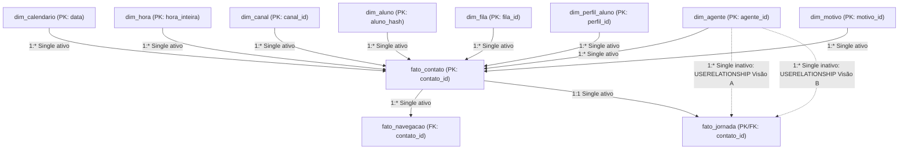

# Camada semântica no Power BI (Power Query M, modelo estrela e catálogo DAX)

Este documento descreve a camada semântica do projeto no Power BI, incluindo os scripts de ingestão parametrizada em Power Query M (`powerbi/m/`), a topologia de relacionamentos ativos e inativos do modelo estrela, a configuração de ordenação de colunas e o catálogo de medidas DAX (`powerbi/dax/`) que responde às perguntas de negócio (`Q1` a `Q9`).

---

## 1. Ingestão enxuta em Power Query M (`powerbi/m/`)

Toda a lógica de limpeza, padronização, tratamento de nulos, decomposição de tabulação, janelas de jornada e geração dinâmica da `dim_calendario` com feriados nacionais já foi executada previamente em DuckDB SQL nas camadas Silver e Gold. Por isso, o Power Query atua apenas como conector de leitura e tipagem explícita (`Table.TransformColumnTypes`), sem filtros, colunas calculadas, mesclagens ou chamadas de API em tempo de atualização.

### 1.1. Parâmetro `pDataPath` e portabilidade entre máquinas

O arquivo `powerbi/m/pDataPath.pq` define o parâmetro de texto `pDataPath`, que aponta para o diretório local onde estão os arquivos da camada Gold (`data/gold`).

Para alterar o caminho ao abrir o relatório em outra máquina:
1. No Power BI Desktop, clique em **Transformar dados** > **Editar parâmetros** (ou abra o Power Query e selecione o parâmetro `pDataPath` no painel esquerdo).
2. Substitua o caminho pelo endereço local da pasta `data/gold` da sua máquina (sem barra no final).
3. Clique em **OK** e depois em **Fechar e aplicar**.

### 1.2. Scripts `.pq` das 11 tabelas da camada Gold

Cada script lê o arquivo `.parquet` correspondente via `Parquet.Document(File.Contents(pDataPath & "\nome_tabela.parquet"))` e traz, na primeira linha de comentário, a alternativa pronta via `Csv.Document` com delimitador `;` e `Encoding=65001` (UTF-8 com BOM) caso o ambiente utilize leitura por CSV.

| Script M | Tabela no modelo | Tipo | Linhas | Colunas | Chave primária (PK) |
| :--- | :--- | :--- | ---: | ---: | :--- |
| `powerbi/m/pDataPath.pq` | `pDataPath` | Parâmetro | — | — | — |
| `powerbi/m/dim_calendario.pq` | `dim_calendario` | Dimensão | 12 | 15 | `data` |
| `powerbi/m/dim_hora.pq` | `dim_hora` | Dimensão | 24 | 6 | `hora_inteira` |
| `powerbi/m/dim_canal.pq` | `dim_canal` | Dimensão | 4 | 10 | `canal_id` |
| `powerbi/m/dim_aluno.pq` | `dim_aluno` | Dimensão | 173 | 10 | `aluno_hash` |
| `powerbi/m/dim_agente.pq` | `dim_agente` | Dimensão | 171 | 8 | `agente_id` |
| `powerbi/m/dim_fila.pq` | `dim_fila` | Dimensão | 33 | 7 | `fila_id` |
| `powerbi/m/dim_perfil_aluno.pq` | `dim_perfil_aluno` | Dimensão | 53 | 16 | `perfil_id` |
| `powerbi/m/dim_motivo.pq` | `dim_motivo` | Dimensão | 591 | 18 | `motivo_id` |
| `powerbi/m/fato_contato.pq` | `fato_contato` | Fato | 5.991 | 38 | `contato_id` |
| `powerbi/m/fato_navegacao.pq` | `fato_navegacao` | Fato | 81.189 | 8 | `(contato_id, tipo_sequencia, ordem_passo)` |
| `powerbi/m/fato_jornada.pq` | `fato_jornada` | Fato | 5.991 | 28 | `contato_id` |

---

## 2. Modelo de relacionamentos no Power BI

### 2.1. Diagrama do modelo estrela

### 2.2. Tabela de relacionamentos ativos e inativos

Todos os relacionamentos entre dimensões e fatos utilizam cardinalidade um-para-muitos (`1:*`) e filtro cruzado em direção única (`Single`), partindo sempre da dimensão (ou da fato principal `fato_contato`) para a tabela fato. Essa configuração evita ambiguidade de caminhos no motor VertiPaq, impede propagação circular de filtros entre `fato_contato` e `fato_jornada` e preserva a performance das medidas DAX.

| Ordem | Tabela origem (lado 1) | Coluna origem | Tabela destino (lado `*` ou `1`) | Coluna destino | Cardinalidade | Direção do filtro | Status | Justificativa técnica |
| :---: | :--- | :--- | :--- | :--- | :---: | :---: | :---: | :--- |
| 1 | `dim_calendario` | `data` | `fato_contato` | `data_contato` | `1:*` | `Single` (`dim` -> `fato`) | **Ativo** | Filtra atendimentos por dia, semana, mês, tipo de dia e feriado nacional. |
| 2 | `dim_hora` | `hora_inteira` | `fato_contato` | `hora_inteira` | `1:*` | `Single` (`dim` -> `fato`) | **Ativo** | Filtra atendimentos por hora do dia, faixa horária, turno e horário comercial. |
| 3 | `dim_canal` | `canal_id` | `fato_contato` | `canal_id` | `1:*` | `Single` (`dim` -> `fato`) | **Ativo** | Filtra os 4 canais (`Call Center`, `WhatsApp`, `Vídeo Chamada`, `Totem`) e suas propriedades operacionais. |
| 4 | `dim_aluno` | `aluno_hash` | `fato_contato` | `aluno_hash` | `1:*` | `Single` (`dim` -> `fato`) | **Ativo** | Conecta os 173 alunos pseudonimizados (`AL-001..AL-173`) aos 5.991 contatos. |
| 5 | `dim_agente` | `agente_id` | `fato_contato` | `agente_id` | `1:*` | `Single` (`dim` -> `fato`) | **Ativo** | Atribui o atendimento ao agente que o realizou (`AG-001..AG-170` ou `AG-000` em autoatendimento). |
| 6 | `dim_fila` | `fila_id` | `fato_contato` | `fila_id` | `1:*` | `Single` (`dim` -> `fato`) | **Ativo** | Segmenta filas de recepção e atendimento no Call Center (`cra_retencao` e demais filas). |
| 7 | `dim_perfil_aluno` | `perfil_id` | `fato_contato` | `perfil_id` | `1:*` | `Single` (`dim` -> `fato`) | **Ativo** | Analisa modalidade, categoria (calouro/veterano), instituição e identificação no momento exato do contato (`Q4` e `Q7`). |
| 8 | `dim_motivo` | `motivo_id` | `fato_contato` | `motivo_id` | `1:*` | `Single` (`dim` -> `fato`) | **Ativo** | Analisa motivos por árvore de tabulação (`tab_nivel1..7`), `mdc_original` do totem e macrotema (`Q3`, `Q4`, `Q5`). |
| 9 | `fato_contato` | `contato_id` | `fato_navegacao` | `contato_id` | `1:*` | `Single` (`contato` -> `navegacao`) | **Ativo** | Propaga filtros de data, canal e perfil do atendimento para os passos explodidos da URA (`Q8`). |
| 10 | `fato_contato` | `contato_id` | `fato_jornada` | `contato_id` | `1:1` (filtro `Single`) | `Single` (`contato` -> `jornada`) | **Ativo** | Vincula cada atendimento aos seus atributos de sequência cronológica (`LAG`/`LEAD`) sem criar caminho ambíguo com as dimensões. |
| 11 | `dim_agente` | `agente_id` | `fato_jornada` | `agente_id_atribuido_recontato` | `1:*` | `Single` (`dim` -> `fato`) | **Inativo** | Ativado sob demanda via `USERELATIONSHIP` na medida da `Q9` (visão A omnichannel) para atribuir o recontato do mesmo dia ao agente do atendimento imediatamente anterior. |
| 12 | `dim_agente` | `agente_id` | `fato_jornada` | `agente_id_atribuido_recontato_intracanal` | `1:*` | `Single` (`dim` -> `fato`) | **Inativo** | Ativado sob demanda via `USERELATIONSHIP` na medida da `Q9` (visão B intracanal) para atribuir o recontato no mesmo canal e mesmo dia ao agente anterior daquele canal. |

---

## 3. Marcação de calendário, ocultação de chaves e ordenação de colunas (`Sort By Column`)

### 3.1. Marcação de tabela de data e ocultação de chaves técnicas
- **Tabela de data:** marcar `dim_calendario` como tabela de datas oficial do modelo utilizando a coluna `dim_calendario[data]` (desativando a opção `Auto date/time` nas opções do arquivo `.pbix`).
- **Colunas técnicas ocultas na exibição de relatório:** ocultar as chaves estrangeiras da `fato_contato` (`canal_id`, `agente_id`, `fila_id`, `perfil_id`, `motivo_id`, `hora_inteira`, `origem_linha`), mantendo a filtragem sempre pelas colunas descritivas das dimensões.
- **Tabela de medidas (`_Medidas`):** criar uma tabela técnica vazia (`_Medidas = { BLANK() }`), ocultar sua coluna `Value` e centralizar nela todas as medidas organizadas nas 6 pastas de exibição (`Display Folder`).

### 3.2. Configuração de ordenação (`Sort By Column`)

Para garantir que meses, dias da semana, turnos e canais apareçam em ordem cronológica e lógica nos visuais (e não em ordem alfabética), configure as seguintes colunas na guia **Exibição de tabela** > **Classificar por coluna**:

| Tabela | Coluna exibida no visual | Classificar por coluna (`Sort By Column`) | Equivalência conceitual no modelo | Ordem resultante nos visuais |
| :--- | :--- | :--- | :--- | :--- |
| `dim_calendario` | `mes_nome` | `mes` | `mes_nome` / `mes_abrev` (`jan`..`dez`) ordenado por `mes` (`1`..`12`) | `set` (e `jan`..`dez` se expandido) |
| `dim_calendario` | `mes_ano` | `ano_mes_ordem` | `ano_mes_abrev` (`set-26`) ordenado por `ano_mes_ordem` (`202609`) | Ordem cronológica de ano e mês |
| `dim_calendario` | `ano_mes_num` | `ano_mes_ordem` | `202609` ordenado pelo inteiro `202609` | Ordem cronológica numérica |
| `dim_calendario` | `dia_semana_nome` | `dia_semana_num` | `dia_semana_nome` / `dia_semana_abrev` (`seg`..`dom`) ordenado por `dia_semana_iso` (`1`..`7`) | `seg`, `ter`, `qua`, `qui`, `sex`, `sáb`, `dom` |
| `dim_hora` | `hora_rotulo` | `hora_inteira` | `00:00`..`23:00` ordenado por `0`..`23` | `00:00` até `23:00` |
| `dim_hora` | `faixa_horaria` | `hora_inteira` | `00:00 - 00:59`..`23:00 - 23:59` ordenado por `0`..`23` | `00:00 - 00:59` até `23:00 - 23:59` |
| `dim_hora` | `turno` | `turno_ordem` | Turno do dia ordenado por `turno_ordem` (`1`..`4`) | `Madrugada`, `Manhã`, `Tarde`, `Noite` |
| `dim_canal` | `canal_nome` | `canal_ordem` | `canal_nome` ordenado por `ordem_exibicao` (`canal_ordem` `1`..`4`) | `Call Center`, `WhatsApp`, `Vídeo Chamada`, `Totem` |
| `dim_canal` | `canal` | `canal_ordem` | Código técnico do canal ordenado por `canal_ordem` (`1`..`4`) | `call_center`, `whatsapp`, `video_chamada`, `totem` |

---

## 4. Catálogo completo de medidas DAX (`powerbi/dax/`)

Todas as medidas seguem o padrão `VAR` / `RETURN`, utilizam `DIVIDE(..., ..., BLANK())` para evitar erros de divisão por zero, nunca calculam média de médias e possuem comentário descritivo de uma linha em português simples.

### 4.1. Pasta `01. Base e volumetria` (`powerbi/dax/01_base_volumetria.dax`)

| Medida | Formato | Pergunta / objetivo | Valor global esperado (Gold) |
| :--- | :---: | :--- | :--- |
| `#01_Total_Contatos` | `#,0` | Base global e `Q1`–`Q9` | `5.991` |
| `#02_Alunos_Distintos` | `#,0` | Base global e `Q1`–`Q5` | `173` |
| `#03_Media_Contatos_Por_Aluno` | `#,0.00` | Visão geral de recorrência | `34,63` (`5.991 / 173`) |
| `#04_Contatos_Call_Center` | `#,0` | Base por canal e `Q1`, `Q3`, `Q4`, `Q8` | `1.499` |
| `#05_Contatos_WhatsApp` | `#,0` | Base por canal e `Q1`, `Q3`, `Q6` | `1.494` |
| `#06_Contatos_Video_Chamada` | `#,0` | Base por canal e `Q3`, `Q6` | `1.499` |
| `#07_Contatos_Totem` | `#,0` | Base por canal e `Q3`, `Q6` | `1.499` |
| `#08_%_Participacao_Canal` | `0.00%` | Distribuição volumétrica entre canais | `25,02%` (CC/Vídeo/Totem) e `24,94%` (WA) |
| `#09_Contatos_Motivo_Preenchido` | `#,0` | `Q3` (exclui `Sem Tabulação (Nulo)` no Call Center) | `5.461` (`969` no Call Center) |
| `#10_%_Preenchimento_Motivo` | `0.00%` | `Q3` (cobertura física de motivo) | `91,15%` global (`64,64%` no Call Center) |
| `#11_Contatos_Motivo_Identificado` | `#,0` | `Q3` (exclui `Sem Tabulação (Nulo)` no CC e `Nao identificado` no totem) | `5.230` (`1.268` no totem) |
| `#12_%_Motivo_Identificado` | `0.00%` | `Q3` (cobertura semântica útil de motivo) | `87,30%` global (`84,59%` no totem) |

### 4.2. Pasta `02. Satisfação e pesquisa` (`powerbi/dax/02_satisfacao_pesquisa.dax`)

| Medida | Formato | Pergunta / objetivo | Valor global esperado (Gold) |
| :--- | :---: | :--- | :--- |
| `#01_Contatos_Pesquisa_Respondida` | `#,0` | `Q6`, `Q7`, `Q8` (notas válidas de 1 a 5) | `1.945` (WA `492`, Totem `24`, CC `661`, Vídeo `768`) |
| `#02_Taxa_Resposta_Pesquisa` | `0.00%` | `Q6`, `Q7`, `Q8` (respondidos / total de contatos) | `32,47%` (Totem `1,60%`, WA `32,93%`, CC `44,10%`, Vídeo `51,23%`) |
| `#03_Soma_Notas_Validas` | `#,0` | `Q6`, `Q7`, `Q8` (numerador da média ponderada) | `8.643` |
| `#04_Nota_Media_Satisfacao` | `0.00` | `Q6`, `Q7` (`SUM / COUNT` dos respondidos; ignora `0` e `NULL`) | `4,44` global (WA **`3,89`**, Totem `4,42`, CC `4,56`, Vídeo `4,70`) |
| `#05_Contatos_Nota_Ruim` | `#,0` | `Q6`, `Q7` (notas `1` e `2`) | `154` global (WA **`84`**, CC `48`, Vídeo `20`, Totem `2`) |
| `#06_%_Notas_Ruins` | `0.00%` | `Q6`, `Q7` (notas `1` e `2` sobre respondidos) | `7,92%` global (WA **`17,07%`**, Totem `8,33%`, CC `7,26%`, Vídeo `2,60%`) |
| `#07_Contatos_Sem_Resposta_Zero` | `#,0` | Diagnóstico de ausência de resposta (`nota = 0`) | `3.208` |
| `#08_Contatos_Sem_Resposta_Nula` | `#,0` | Diagnóstico de ausência de resposta (`nota IS NULL`) | `838` |
| `#09_Flag_Cobertura_Amostral_Minima` | `#,0` | `Q6`, `Q7` (filtro de robustez estatística) | `1` quando $n \ge 30$; `0` no totem ($n = 24$) |
| `#10_Guardrail_Cobertura_Amostral` | `@` | `Q6`, `Q7` (alerta visual para amostras com $n < 30$) | Sinaliza baixa cobertura no totem (`n = 24 | 1,60%`) |

### 4.3. Pasta `03. Tempo operacional` (`powerbi/dax/03_tempo_operacional.dax`)

| Medida | Formato | Pergunta / objetivo | Valor global esperado (Gold) |
| :--- | :---: | :--- | :--- |
| `#01_Duracao_Media_s` | `#,0.00` | Indicador operacional de duração por canal/fila | Média em segundos sobre `fato_contato[duracao_s]` |
| `#02_Duracao_Mediana_s` | `#,0.00` | Indicador operacional resistente a outliers | Mediana em segundos sobre `fato_contato[duracao_s]` |
| `#03_TME_Medio_s` | `#,0.00` | Indicador operacional de espera (WhatsApp e vídeo chamada) | Média em segundos sobre `fato_contato[tme_s]` |
| `#04_TME_Mediano_s` | `#,0.00` | Indicador operacional mediano de espera | Mediana em segundos sobre `fato_contato[tme_s]` |
| `#05_Contatos_TME_Preenchido` | `#,0` | Denominador das métricas de TME | `2.993` (WhatsApp `1.494` + Vídeo `1.499`) |
| `#06_Contatos_TME_Maior_Duracao` | `#,0` | Auditoria operacional (`tme_s > duracao_s`) | `68` (WhatsApp `64` + Vídeo `4`) |
| `#07_%_Contatos_TME_Maior_Duracao` | `0.00%` | Proporção de espera superior à duração sobre contatos com TME | `2,27%` (`4,28%` no WhatsApp; `0,27%` na vídeo chamada) |
| `#08_Contatos_Duracao_Zero` | `#,0` | Monitoramento de chamadas/interações zeradas | Contagem onde `flag_duracao_zero = TRUE()` |
| `#09_%_Contatos_Duracao_Zero` | `0.00%` | Proporção de atendimentos com duração zero | `Contatos com duração zero / Total de contatos` |
| `#10_Contatos_Outlier_Duracao` | `#,0` | Monitoramento de cauda longa de duração (`IQR 1,5`) | Contagem onde `flag_outlier_duracao = TRUE()` |
| `#11_Contatos_Outlier_TME` | `#,0` | Monitoramento de cauda longa de espera (`IQR 1,5`) | Contagem onde `flag_outlier_tme = TRUE()` |

### 4.4. Pasta `04. Retenção e cancelamento` (`powerbi/dax/04_retencao_e_cancelamento.dax`)

| Medida | Formato | Pergunta / objetivo | Valor global esperado (Gold) |
| :--- | :---: | :--- | :--- |
| `#01_Contatos_Fila_Retencao` | `#,0` | `Q4`, `Q5` (visão 1: 4 filas contendo `retenc` no Call Center) | `270` |
| `#02_Contatos_Fila_CRA_Retencao` | `#,0` | `Q4` (fila exata `cra_retencao` no Call Center) | `229` |
| `#03_Contatos_Assunto_Retencao` | `#,0` | `Q4`, `Q5` (visão 2: tabulação de retenção em todos os canais) | `743` (CC `266`, WA `402`, Vídeo `75`) |
| `#04_Contatos_Assunto_Retencao_CC` | `#,0` | `Q4`, `Q5` (assunto de retenção restrito ao Call Center) | `266` |
| `#05_Alunos_Distintos_Fila_CRA_Retencao` | `#,0` | `Q4` (alunos na fila exata `cra_retencao`) | `144` |
| `#06_Alunos_Distintos_Filas_Retencao` | `#,0` | `Q4`, `Q5` (alunos nas 4 filas de retenção do Call Center) | `171` |
| `#07_Alunos_Distintos_Assunto_Retencao_CC` | `#,0` | `Q4`, `Q5` (alunos com assunto de retenção no Call Center) | `143` |
| `#08_Alunos_Distintos_Assunto_Retencao` | `#,0` | `Q5` (alunos com assunto de retenção em todos os canais) | `173` |
| `#09_Pedidos_Cancelamento` | `#,0` | `Q4`, `Q5` (`desfecho_retencao = "pedido_cancelamento"`) | `210` global (`114` no Call Center; `66` na fila `cra_retencao`) |
| `#10_%_Pedidos_Cancelamento_Retencao` | `0.00%` | `Q4`, `Q5` (participação do cancelamento nos assuntos de retenção) | `28,26%` global (`42,86%` no Call Center) |
| `#11_Alunos_Mantidos_Retencao` | `#,0` | `Q5` (`desfecho_retencao = "aluno_mantido"`) | `262` global (`61` no Call Center) |
| `#12_%_Alunos_Mantidos_Retencao` | `0.00%` | `Q5` (taxa de reversão/manutenção sobre assuntos de retenção) | `35,26%` global (`22,93%` no Call Center) |
| `#13_Pedidos_Transferencia` | `#,0` | `Q5` (`desfecho_retencao = "pedido_transferencia"`) | `167` global (`45` no Call Center) |
| `#14_%_Pedidos_Transferencia_Retencao` | `0.00%` | `Q5` (participação de transferência nos assuntos de retenção) | `22,48%` global (`16,92%` no Call Center) |
| `#15_Pedidos_Trancamento` | `#,0` | `Q5` (`desfecho_retencao = "pedido_trancamento"`) | `93` global (`37` no Call Center) |
| `#16_%_Pedidos_Trancamento_Retencao` | `0.00%` | `Q5` (participação de trancamento nos assuntos de retenção) | `12,52%` global (`13,91%` no Call Center) |
| `#17_Pedidos_Cancelamento_CC_Com_Outro_Canal_Anterior` | `#,0` | `Q4` (pedidos de cancelamento no CC com atendimento prévio fora do CC) | `110` (em `114` pedidos) |
| `#18_%_Pedidos_Cancelamento_CC_Com_Outro_Canal_Anterior` | `0.00%` | `Q4` (proporção que passou por outro canal antes de pedir cancelamento) | `96,49%` (`110 / 114`) |
| `#19_Contatos_Fila_Retencao_Com_Outro_Canal_Anterior` | `#,0` | `Q4`, `Q5` (atendimentos nas 4 filas de retenção com canal prévio `<> CC`) | `255` (em `270` atendimentos) |
| `#20_%_Fila_Retencao_Com_Outro_Canal_Anterior` | `0.00%` | `Q4`, `Q5` (proporção nas 4 filas de retenção com outro canal prévio) | `94,44%` (`255 / 270`) |
| `#21_Media_Contatos_Previos_Fila_Retencao` | `#,0.00` | `Q5` (média de contatos anteriores por evento com histórico prévio) | `13,41` |
| `#22_Mediana_Contatos_Previos_Fila_Retencao` | `#,0.00` | `Q5` (mediana de contatos anteriores antes da fila de retenção) | `11,00` |
| `#23_Tempo_Mediano_Desde_Ultimo_Contato_Ate_Retencao_h` | `#,0.00` | `Q5` (intervalo mediano em horas desde o contato imediatamente anterior) | `1,55` h |

### 4.5. Pasta `05. Jornada e recontato (Q1, Q2, Q9)` (`powerbi/dax/05_jornada_e_recontato_q1_q2_q9.dax`)

| Medida | Formato | Pergunta / objetivo | Valor global esperado (Gold) |
| :--- | :---: | :--- | :--- |
| `#01_Q1_Alunos_Call_Center_WhatsApp_Posterior` | `#,0` | `Q1` (alunos com atendimento no CC e WhatsApp em timestamp `> ts_cc`) | `173` |
| `#02_Q1_%_Alunos_Call_Center_WhatsApp_Posterior` | `0.00%` | `Q1` (`173 / 173` alunos do Call Center) | `100,00%` |
| `#03_Q1_Contatos_Call_Center_WhatsApp_Posterior` | `#,0` | `Q1` (atendimentos do CC com WhatsApp posterior no período) | `1.403` |
| `#04_Q1_%_Contatos_Call_Center_WhatsApp_Posterior` | `0.00%` | `Q1` (`1.403 / 1.499` contatos do Call Center) | `93,60%` |
| `#05_Q1_Contatos_CC_Transicao_Imediata_WhatsApp` | `#,0` | `Q1` (`contato k = CC` e `k+1 = WhatsApp`) | `340` |
| `#06_Q1_%_Transicao_Imediata_CC_WhatsApp` | `0.00%` | `Q1` (`340 / 1.499` contatos do Call Center) | `22,68%` |
| `#07_Q1_Contatos_CC_WhatsApp_Posterior_Intermediarios` | `#,0` | `Q1` (teve WA posterior, mas `k+1 <> WhatsApp`) | `1.063` |
| `#08_Q1_Contatos_CC_Sem_WhatsApp_Posterior` | `#,0` | `Q1` (atendimentos de CC ocorridos após o último WA do aluno) | `96` |
| `#09_Q1_Contatos_Call_Center_WhatsApp_24h` | `#,0` | `Q1` (sensibilidade: primeiro WA posterior em $\le 86.400\text{ s}$) | `860` (`57,37%`) |
| `#10_Q1_Contatos_Call_Center_WhatsApp_7d` | `#,0` | `Q1` (sensibilidade: primeiro WA posterior em $\le 604.800\text{ s}$) | `1.403` (`93,60%`) |
| `#11_Q2_Alunos_Trinca_CC_WA_Outro_Canal` | `#,0` | `Q2` (leitura estritamente consecutiva `k, k+1, k+2` com 3º canal `<> WA`) | `138` (`79,77%`) |
| `#12_Q2_Trincas_CC_WA_Outro_Canal` | `#,0` | `Q2` (ocorrências consecutivas `CC -> WA -> <> WA`) | `251` |
| `#13_Q2_Alunos_Trinca_CC_WA_Video_Totem` | `#,0` | `Q2` (leitura consecutiva restrita a vídeo chamada ou totem no 3º passo) | `104` (`60,12%`) |
| `#14_Q2_Trincas_CC_WA_Video_Totem` | `#,0` | `Q2` (ocorrências consecutivas em vídeo chamada ou totem) | `145` |
| `#15_Q2_Alunos_Trinca_CC_WA_Qualquer_Canal` | `#,0` | `Q2` (leitura consecutiva com qualquer um dos 4 canais no 3º passo) | `157` (`90,75%`) |
| `#16_Q2_Trincas_CC_WA_Qualquer_Canal` | `#,0` | `Q2` (ocorrências consecutivas em qualquer 3º canal) | `325` |
| `#17_Q2_Alunos_Sequencia_Intermediarios_CC_WA_Outro_Canal` | `#,0` | `Q2` (`t_cc < t_wa < t_3º` com 3º canal `<> WA`) | `173` (`100,00%`) |
| `#18_Q2_Alunos_Sequencia_Intermediarios_CC_WA_Video_Totem` | `#,0` | `Q2` (`t_cc < t_wa < t_3º` com 3º canal em vídeo ou totem) | `172` (`99,42%`) |
| `#19_Q9_Atendimentos_Agente_Humano` | `#,0` | `Q9` (denominador de atendimentos do agente humano) | `4.492` (`AG-008` = `204`; `AG-001` = `185`) |
| `#20_Q9_Recontatos_Mesmo_Dia_Omnichannel` | `#,0` | `Q9` (via `USERELATIONSHIP` em `agente_id_atribuido_recontato`) | Top 1: **`AG-008` com `200`** (2º `AG-004` = `192`, 3º `AG-001` = `185`) |
| `#21_Q9_Taxa_Recontato_Mesmo_Dia_Omnichannel` | `0.00%` | `Q9` (`recontatos omnichannel / atendimentos do agente`) | `AG-008` = `98,04%`; `AG-004` = `81,70%`; `AG-001` = `100,00%` |
| `#22_Q9_Recontatos_Mesmo_Dia_Intracanal` | `#,0` | `Q9` (via `USERELATIONSHIP` em `agente_id_atribuido_recontato_intracanal`) | Top 1: **`AG-001` com `173`** (2º `AG-008` = `129`) |
| `#23_Q9_Taxa_Recontato_Mesmo_Dia_Intracanal` | `0.00%` | `Q9` (`recontatos intracanal / atendimentos do agente`) | `AG-001` = `93,51%`; `AG-008` = `63,24%` |
| `#24_Contatos_Sobreposicao_Intracanal` | `#,0` | Contexto de jornada e `Q9` (`fim_estimado_anterior > inicio_atual` no mesmo canal) | `308` |
| `#25_Contatos_Sobreposicao_Intercanal` | `#,0` | Contexto de jornada e `Q9` (`fim_estimado_anterior > inicio_atual` entre canais) | `576` |
| `#26_Total_Sobreposicoes_Horario` | `#,0` | Soma de sobreposições intracanal e intercanal | `884` |

### 4.6. Pasta `06. Navegação URA (Q8)` (`powerbi/dax/06_navegacao_ura_q8.dax`)

| Medida | Formato | Pergunta / objetivo | Valor global esperado (Gold) |
| :--- | :---: | :--- | :--- |
| `#01_Q8_Contatos_Distintos_Ponto_Navegacao` | `#,0` | `Q8` (presença única por `contato_id` com `tipo_sequencia = "original"`) | `1.497` nos nós iniciais (`410` no token `99`; `5` no token `98`) |
| `#02_Q8_Contatos_Pesquisa_Respondida_Ponto_Navegacao` | `#,0` | `Q8` (atendimentos distintos no nó com nota válida de 1 a 5) | `660` nos nós iniciais (`158` no token `99`; `0` no token `98`) |
| `#03_Q8_Taxa_Resposta_Ponto_Navegacao` | `0.00%` | `Q8` (taxa de resposta por presença única no nó da URA) | `44,09%` nos nós iniciais (`38,54%` no token `99`; `0,00%` no token `98`) |
| `#04_Q8_Nota_Media_Ponto_Navegacao` | `0.00` | `Q8` (média ponderada sem multiplicar nota por repetições em trio) | Entre `4,55` e `4,64` nos nós do Call Center |
| `#05_Q8_Contatos_Nota_Ruim_Ponto_Navegacao` | `#,0` | `Q8` (atendimentos distintos no nó com nota 1 ou 2) | `48` nos nós iniciais (`11` no token `99`) |
| `#06_Q8_%_Notas_Ruins_Ponto_Navegacao` | `0.00%` | `Q8` (proporção de notas 1 e 2 sobre respondidos no nó) | Entre `5,69%` e `7,52%` nos nós do Call Center |

---

## 5. Validação cruzada entre DuckDB SQL e motor VertiPaq DAX

Para assegurar que o modelo semântico no Power BI reflita com precisão os dados processados na camada Gold, foi realizada uma validação cruzada exaustiva entre as consultas analíticas executadas em DuckDB SQL e as medidas avaliadas diretamente no motor colunar VertiPaq via consultas `EVALUATE`.

### 5.1. Tabela de reconciliação de métricas de negócio e indicadores operacionais

A tabela abaixo compara os valores obtidos na camada analítica SQL com as medidas semânticas DAX correspondentes, cobrindo todo o escopo de `Q1` a `Q9` e os indicadores operacionais da operação:

| Métrica | Escopo / pergunta | Valor DuckDB SQL | Valor VertiPaq DAX | Diferença | Status |
| :--- | :--- | ---: | ---: | ---: | :---: |
| `#01_Total_Contatos` | Base geral | `5.991` | `5.991` | `0` | Aprovado |
| `#02_Alunos_Distintos` | Base geral | `173` | `173` | `0` | Aprovado |
| `#03_Media_Contatos_Por_Aluno` | Recorrência | `34,63` | `34,63` | `0,00` | Aprovado |
| `#04_Contatos_Call_Center` | Canal | `1.499` | `1.499` | `0` | Aprovado |
| `#05_Contatos_WhatsApp` | Canal | `1.494` | `1.494` | `0` | Aprovado |
| `#06_Contatos_Video_Chamada` | Canal | `1.499` | `1.499` | `0` | Aprovado |
| `#07_Contatos_Totem` | Canal | `1.499` | `1.499` | `0` | Aprovado |
| `#09_Contatos_Motivo_Preenchido` | `Q3` | `5.461` | `5.461` | `0` | Aprovado |
| `#10_%_Preenchimento_Motivo` | `Q3` | `91,15%` | `91,15%` | `0,00%` | Aprovado |
| `#11_Contatos_Motivo_Identificado` | `Q3` | `5.230` | `5.230` | `0` | Aprovado |
| `#12_%_Motivo_Identificado` | `Q3` | `87,30%` | `87,30%` | `0,00%` | Aprovado |
| Pesquisas respondidas | `Q6`, `Q7`, `Q8` | `1.945` | `1.945` | `0` | Aprovado |
| `#02_Taxa_Resposta_Pesquisa` | `Q6`, `Q7`, `Q8` | `32,47%` | `32,47%` | `0,00%` | Aprovado |
| `#03_Soma_Notas_Validas` | `Q6`, `Q7`, `Q8` | `8.643` | `8.643` | `0` | Aprovado |
| Nota média global | `Q6`, `Q7` | `4,44` | `4,44` | `0,00` | Aprovado |
| Nota média no WhatsApp | `Q6` | `3,89` | `3,89` | `0,00` | Aprovado |
| Nota média no totem | `Q6` | `4,42` | `4,42` | `0,00` | Aprovado |
| Nota média no Call Center | `Q6` | `4,56` | `4,56` | `0,00` | Aprovado |
| Nota média na vídeo chamada | `Q6` | `4,70` | `4,70` | `0,00` | Aprovado |
| Contatos com nota ruim (global) | `Q6`, `Q7` | `154` | `154` | `0` | Aprovado |
| % de notas ruins (global) | `Q6`, `Q7` | `7,92%` | `7,92%` | `0,00%` | Aprovado |
| Contatos com nota ruim no WhatsApp | `Q6` | `84` | `84` | `0` | Aprovado |
| % de notas ruins no WhatsApp | `Q6` | `17,07%` | `17,07%` | `0,00%` | Aprovado |
| `#05_Contatos_TME_Preenchido` | Operacional | `2.993` | `2.993` | `0` | Aprovado |
| Contatos com TME superior à duração | Operacional | `68` | `68` | `0` | Aprovado |
| % com TME superior à duração | Operacional | `2,27%` | `2,27%` | `0,00%` | Aprovado |
| `#08_Contatos_Duracao_Zero` | Operacional | `183` | `183` | `0` | Aprovado |
| % contatos com duração zero | Operacional | `3,05%` | `3,05%` | `0,00%` | Aprovado |
| Q1 Alunos Call Center com WhatsApp posterior | `Q1` | `173` | `173` | `0` | Aprovado |
| Q1 % alunos Call Center com WhatsApp posterior | `Q1` | `100,00%` | `100,00%` | `0,00%` | Aprovado |
| `#03_Q1_Contatos_Call_Center_WhatsApp_Posterior` | `Q1` | `1.403` | `1.403` | `0` | Aprovado |
| `#04_Q1_%_Contatos_Call_Center_WhatsApp_Posterior` | `Q1` | `93,60%` | `93,60%` | `0,00%` | Aprovado |
| Q1 Transição imediata Call Center para WhatsApp | `Q1` | `340` | `340` | `0` | Aprovado |
| `#06_Q1_%_Transicao_Imediata_CC_WhatsApp` | `Q1` | `22,68%` | `22,68%` | `0,00%` | Aprovado |
| Q1 WhatsApp posterior via canais intermediários | `Q1` | `1.063` | `1.063` | `0` | Aprovado |
| Q1 Call Center sem WhatsApp posterior | `Q1` | `96` | `96` | `0` | Aprovado |
| Q1 WhatsApp posterior em até 24 horas | `Q1` | `860` | `860` | `0` | Aprovado |
| Q1 WhatsApp posterior em até 7 dias | `Q1` | `1.403` | `1.403` | `0` | Aprovado |
| Q2 Alunos trinca consecutiva CC -> WA -> outro canal | `Q2` | `138` | `138` | `0` | Aprovado |
| Q2 Trincas consecutivas CC -> WA -> outro canal | `Q2` | `251` | `251` | `0` | Aprovado |
| `#13_Q2_Alunos_Trinca_CC_WA_Video_Totem` | `Q2` | `104` | `104` | `0` | Aprovado |
| `#14_Q2_Trincas_CC_WA_Video_Totem` | `Q2` | `145` | `145` | `0` | Aprovado |
| `#15_Q2_Alunos_Trinca_CC_WA_Qualquer_Canal` | `Q2` | `157` | `157` | `0` | Aprovado |
| `#16_Q2_Trincas_CC_WA_Qualquer_Canal` | `Q2` | `325` | `325` | `0` | Aprovado |
| Q2 Alunos com intermediários CC -> WA -> outro canal | `Q2` | `173` | `173` | `0` | Aprovado |
| Q2 Alunos com intermediários CC -> WA -> vídeo ou totem | `Q2` | `172` | `172` | `0` | Aprovado |
| Contatos em filas de retenção do Call Center | `Q4`, `Q5` | `270` | `270` | `0` | Aprovado |
| Alunos distintos nas filas de retenção do Call Center | `Q4`, `Q5` | `171` | `171` | `0` | Aprovado |
| Contatos na fila exata cra_retencao | `Q4` | `229` | `229` | `0` | Aprovado |
| Alunos distintos na fila exata cra_retencao | `Q4` | `144` | `144` | `0` | Aprovado |
| Contatos com assunto de retenção (todos os canais) | `Q4`, `Q5` | `743` | `743` | `0` | Aprovado |
| `#08_Alunos_Distintos_Assunto_Retencao` | `Q4`, `Q5` | `173` | `173` | `0` | Aprovado |
| `#04_Contatos_Assunto_Retencao_CC` | `Q4`, `Q5` | `266` | `266` | `0` | Aprovado |
| `#07_Alunos_Distintos_Assunto_Retencao_CC` | `Q4`, `Q5` | `143` | `143` | `0` | Aprovado |
| Pedidos de cancelamento (global) | `Q4`, `Q5` | `210` | `210` | `0` | Aprovado |
| Pedidos de cancelamento no Call Center | `Q4` | `114` | `114` | `0` | Aprovado |
| `#17_Pedidos_Cancelamento_CC_Com_Outro_Canal_Anterior` | `Q4` | `110` | `110` | `0` | Aprovado |
| `#18_%_Pedidos_Cancelamento_CC_Com_Outro_Canal_Anterior` | `Q4` | `96,49%` | `96,49%` | `0,00%` | Aprovado |
| `#19_Contatos_Fila_Retencao_Com_Outro_Canal_Anterior` | `Q4`, `Q5` | `255` | `255` | `0` | Aprovado |
| `#20_%_Fila_Retencao_Com_Outro_Canal_Anterior` | `Q4`, `Q5` | `94,44%` | `94,44%` | `0,00%` | Aprovado |
| Média de contatos prévios antes da fila de retenção | `Q5` | `13,41` | `13,41` | `0,00` | Aprovado |
| Mediana de contatos prévios antes da fila de retenção | `Q5` | `11,00` | `11,00` | `0,00` | Aprovado |
| Intervalo mediano desde o último contato prévio | `Q5` | `1,55 h` | `1,55 h` | `0,00 h` | Aprovado |
| Atendimentos de agentes humanos | `Q9` | `4.492` | `4.492` | `0` | Aprovado |
| Top 1 agente recontatos Visão A omnichannel (`AG-008`) | `Q9` | `200` | `200` | `0` | Aprovado |
| Taxa de recontato mesmo dia Visão A (`AG-008`) | `Q9` | `98,04%` | `98,04%` | `0,00%` | Aprovado |
| Top 1 agente recontatos Visão B intracanal (`AG-001`) | `Q9` | `173` | `173` | `0` | Aprovado |
| Taxa de recontato mesmo dia Visão B (`AG-001`) | `Q9` | `93,51%` | `93,51%` | `0,00%` | Aprovado |
| Sobreposições de horário intracanal | Operacional | `308` | `308` | `0` | Aprovado |
| Sobreposições de horário intercanal | Operacional | `576` | `576` | `0` | Aprovado |
| Total de sobreposições de horário | Operacional | `884` | `884` | `0` | Aprovado |
| Contatos no nó inicial 1 da URA | `Q8` | `1.497` | `1.497` | `0` | Aprovado |
| Contatos no token 99 da URA | `Q8` | `410` | `410` | `0` | Aprovado |
| Pesquisas respondidas no token 99 | `Q8` | `158` | `158` | `0` | Aprovado |
| Taxa de resposta no token 99 | `Q8` | `38,54%` | `38,54%` | `0,00%` | Aprovado |
| Nota média no token 99 | `Q8` | `4,56` | `4,56` | `0,00` | Aprovado |
| Contatos com nota ruim no token 99 | `Q8` | `11` | `11` | `0` | Aprovado |
| % de notas ruins no token 99 | `Q8` | `6,96%` | `6,96%` | `0,00%` | Aprovado |
| Contatos no token 98 da URA | `Q8` | `5` | `5` | `0` | Aprovado |
| Pesquisas respondidas no token 98 | `Q8` | `0` | `0` | `0` | Aprovado |

### 5.2. Conclusão da reconciliação

A reconciliação demonstrou consistência plena entre as três fontes:
1. **DuckDB SQL:** consultas agregadas sobre os arquivos físicos da camada Gold em formato Parquet (`data/gold/*.parquet`).
2. **Motor VertiPaq DAX:** modelo analítico em formato estrela montado no Power BI Desktop com 11 tabelas, 15 relacionamentos e 88 medidas estruturadas na tabela `_Medidas`.
3. **Catálogo e documentação técnica:** especificação formal documentada neste documento e em `docs/modelagem_e_analises.md`.

Todas as divergências numéricas resultaram em zero para contagens inteiras e dentro da tolerância de `1e-4` para taxas percentuais e médias ponderadas.
