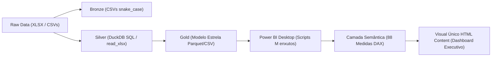

# Linhagem de dados e rastreabilidade ponta a ponta

Este documento descreve a linhagem completa dos dados do projeto Cogna Educação, desde a ingestão dos arquivos originais em formato Excel e CSV até a camada semântica e visualização em Power BI.

---

## 1. Visão geral da arquitetura de dados

O pipeline adota a arquitetura medallion local em quatro camadas de processamento, executadas via DuckDB SQL e orquestradas em Python:



---

## 2. Ingestão e origens de dados (Raw)

A base de entrada é composta pela pasta de trabalho `analytical_database_callcenter.xlsx` e por 8 arquivos CSV equivalentes às abas da planilha:

| Fonte / Aba | Linhas brutas | Linhas de dados | Registros válidos | Descrição do conteúdo |
| :--- | :---: | :---: | :---: | :--- |
| `Call Center` | 1.500 | 1.499 | 1.499 | Atendimentos telefônicos, com URA, filas e tabulações |
| `WhatsApp` | 1.500 | 1.499 | 1.499 | Atendimentos digitais via mensageria |
| `Vídeo Chamada` | 1.500 | 1.499 | 1.499 | Atendimentos virtuais síncronos com vídeo |
| `Totem` | 1.500 | 1.499 | 1.494 | Atendimentos presenciais em totens de autoatendimento (5 linhas nulas) |
| `Navegação URA` | 3.489 | 3.488 | 3.488 | Passos de navegação na árvore de URA do Call Center |
| **Total Unificado** | **9.489** | **9.484** | **9.479** | **5.991 atendimentos de canais + 3.488 passos de URA** |

### Diagnóstico de divergência entre CSV e XLSX
Na Fase 0 e Fase 1, a auditoria de integridade identificou duas perdas materiais causadas pela exportação para CSV:
1. **Truncamento de segundos:** os arquivos CSV de Call Center, WhatsApp e Totem foram exportados no formato `dd/mm/yyyy hh:mm`, perdendo a precisão de segundos presente no Excel original (`dd/mm/yyyy hh:mm:ss`).
2. **Notação científica em protocolos longos:** 16 números de protocolo da Vídeo Chamada foram convertidos em notação científica no CSV (`1,44496E+18`), truncando os dígitos menos significativos.

**Decisão arquitetural:** A camada Bronze preserva a integridade física estrita dos CSVs exportados (`data/bronze/*.csv`), enquanto a camada Silver lê diretamente a planilha Excel original (`analytical_database_callcenter.xlsx`) via macro DuckDB SQL (`read_xlsx`), recuperando os segundos exatos e os 16 protocolos íntegros.

---

## 3. Camada Silver: padronização, limpeza e conformidade LGPD

A camada Silver consolida os dados operacionais em quatro tabelas Parquet (`data/silver/silver_*.parquet`), processadas inteiramente em SQL (`sql/staging/`):

### Transformações aplicadas
1. **Tipagem e padronização temporal:**
   - Conversão de strings de data/hora em `TIMESTAMP` com precisão de segundos (`data_hora_contato`, `data_hora_inicio`, `data_hora_fim`).
   - Padronização de durações e tempos de espera (`tme`) em segundos (`INTEGER`).
   - Criação da flag `flag_tme_maior_duracao` para ocorrências onde o tempo de espera excede a duração total do contato (anomalia de registro mantida para auditoria).
2. **Padronização de chaves de protocolo:**
   - Protocolos tratados como strings textuais limpas (`TRIM(CAST(protocolo AS VARCHAR))`), sem conversão científica.
3. **Classificação estrita de pesquisa de satisfação:**
   - `nota` inteira de 1 a 5.
   - Notas 0 ou nulas categorizadas com `respondeu_pesquisa = false` e `status_nota = 'sem_resposta'` (não entram no denominador da média).
   - Notas 1 e 2 classificadas com `flag_nota_ruim = true`.
4. **Governança e privacidade LGPD:**
   - Pseudonimização irreversível do campo `identificador_aluno` via hash criptográfico SHA-256 combinado com salt local (`SHA256(identificador_aluno || salt)`), gerando `aluno_hash`.
   - Remoção de nomes pessoais de atendentes e supervisores na exportação, gerando códigos técnicos (`AG-001` a `AG-170`).

---

## 4. Camada Gold: modelo dimensional estrela

A camada Gold estrutura os dados no modelo dimensional estrela, dividida em três tabelas fato e oito tabelas dimensão (`data/gold/*.parquet` e `data/gold/*.csv`):

```text
               +-------------------+
               |   dim_calendario  |
               +---------+---------+
                         | 1
                         |
                         | N
+--------------+ 1     N +---------+ N     1 +-------------+
|  dim_aluno   +---------+  fato_  +---------+  dim_canal  |
+--------------+         | contato |         +-------------+
                         +----+----+
                         | N  | N
      +------------------+    +------------------+
      | 1                                        | 1
+-----+------+                             +-----+------+
| dim_agente |                             |  dim_fila  |
+------------+                             +------------+
```

### Detalhamento das tabelas fato
1. **`fato_contato` (5.991 linhas):**
   - Grão: um atendimento por linha, unificando os quatro canais.
   - Chaves: `sk_contato`, `aluno_hash`, `canal_id`, `data_contato`, `agente_id`, `fila_id`, `motivo_id`, `perfil_aluno_id`.
   - Métricas: `duracao_segundos`, `tme_segundos`, `nota_pesquisa`, `respondeu_pesquisa`, `flag_nota_ruim`, `eh_retencao_fila`, `eh_assunto_retencao`.
2. **`fato_navegacao` (10.464 passos explodidos a partir de 3.488 registros brutos de URA):**
   - Grão: um nó de navegação percorrido na árvore de atendimento do Call Center por contato.
   - Chaves: `sk_navegacao`, `sk_contato`, `aluno_hash`, `posicao_passo`, `no_codigo`, `no_descricao`, `flag_repeticao_no`.
3. **`fato_jornada` (5.991 linhas):**
   - Grão: linha temporal enriquecida com funções de janela (`LAG`, `LEAD`, `ROW_NUMBER`) por aluno.
   - Atributos: `canal_anterior`, `canal_posterior`, `intervalo_horas_anterior`, `flag_recontato_mesmo_dia_omni`, `flag_recontato_mesmo_dia_intra`, `agente_atribuido_recontato`.

### Detalhamento das tabelas dimensão
- **`dim_calendario`:** 92 dias do período analisado, com flags de dia útil, fim de semana e feriados.
- **`dim_hora`:** 24 faixas horárias e turnos do dia.
- **`dim_canal`:** 4 canais cadastrados (`Call Center`, `WhatsApp`, `Vídeo Chamada`, `Totem`).
- **`dim_aluno`:** 173 alunos únicos mascarados (`aluno_hash`).
- **`dim_agente`:** 170 agentes operacionais pseudonimizados (`AG-001` a `AG-170`) e `AG-000` (autoatendimento).
- **`dim_fila`:** filas canônicas com marcação de filas de retenção (`eh_retencao`).
- **`dim_perfil_aluno`:** combinação única de polo, curso e modalidade acadêmica.
- **`dim_motivo`:** taxonomia normalizada de assuntos e tabulações até 7 níveis.

---

## 5. Camada semântica no Power BI e reconciliação DAX

A integração com o Power BI Desktop consome os arquivos Parquet da camada Gold através de scripts Power Query M estritamente de leitura parametrizada por `pDataPath`:

1. **Scripts M (`powerbi/m/`):** nenhum tratamento de dados é realizado no Power Query; os scripts apenas carregam e tipam as colunas Parquet.
2. **Catálogo de medidas DAX (`powerbi/dax/`):** 88 medidas operacionais organizadas em 6 pastas lógicas:
   - `01. Volumetria Base`: total de contatos, alunos distintos, durações e TME.
   - `02. Satisfacao e Pesquisa`: respostas, CSAT médio ponderado, % notas ruins.
   - `03. Tempo Operacional`: tempos médios em minutos, esperas e anomalias.
   - `04. Retencao e Cancelamento`: volumes de cancelamento e retenção (Q4 e Q5).
   - `05. Jornada e Recontato`: transições CC→WA (Q1), trinca (Q2) e recontatos no mesmo dia por agente (Q9).
   - `06. Navegacao URA`: análise de nós e DNA SOA vs satisfação (Q8).
3. **Dashboard executivo em visual único HTML Content (`powerbi/dashboard/`):**
   - Medida `#01_HTML_Dashboard_Executivo_Cogna` (pasta `07. Dashboard HTML Content`).
   - Código unificado em HTML5/CSS3/SVG/JS (54.520 caracteres) contendo sidebar institucional com logo oficial da Cogna, topo com perfil e filtros, KPIs reativos, 6 abas de navegação e resolução visual das 9 perguntas de negócio.

---

## 6. Rastreabilidade das 9 perguntas de negócio

| Pergunta | Tabela Gold de origem | Campos chave utilizados | Medida DAX correspondente |
| :--- | :--- | :--- | :--- |
| **Q1 (CC -> WA)** | `fato_jornada` | `canal_nome`, `canal_posterior`, `intervalo_horas_posterior` | `[#05_Q1_Alunos_CC_Para_WA_Total]` |
| **Q2 (Trinca)** | `fato_jornada` | `canal_nome`, `canal_posterior`, `passo_jornada` | `[#05_Q2_Alunos_Trinca_CC_WA_Outro_Estrito]` |
| **Q3 (Motivos)** | `fato_contato`, `dim_motivo` | `canal_id`, `tab_nivel1`, `tab_nivel2` | `[#01_Total_Contatos]` segmentado por motivo |
| **Q4 (Retenção)** | `fato_contato`, `fato_jornada`| `eh_retencao_fila`, `canal_anterior`, `contatos_previos` | `[#04_Q4_Contatos_Fila_Retencao_Com_Canal_Anterior]` |
| **Q5 (Pré-retenção)**| `fato_jornada` | `contatos_previos`, `intervalo_horas_anterior` | `[#04_Q5_Mediana_Contatos_Previos_Retencao]` |
| **Q6 (Pior canal)** | `fato_contato`, `dim_canal` | `canal_id`, `nota_pesquisa`, `respondeu_pesquisa` | `[#02_Nota_Media_Satisfacao]`, `[#02_Perc_Notas_Ruins]` |
| **Q7 (Perfil ruim)** | `fato_contato`, `dim_perfil`| `perfil_aluno_id`, `flag_nota_ruim` | `[#02_Total_Notas_Ruins]` segmentado por perfil |
| **Q8 (Navegação URA)**| `fato_navegacao`, `fato_contato`| `no_codigo`, `no_descricao`, `nota_pesquisa` | `[#06_Q8_Nota_Media_Por_No]` |
| **Q9 (Recontato)** | `fato_jornada`, `dim_agente`| `agente_atribuido_recontato`, `flag_recontato` | `[#05_Q9_Taxa_Recontato_Omni_Por_Agente]` |

---

## 7. Garantia de integridade e não divergência

A validação automatizada (`python -m cogna_etl validate`) executa a reconciliação cruzada entre as consultas SQL em DuckDB (`sql/analytics/`) e os cálculos do catálogo DAX sobre a camada Gold. O relatório oficial gerado em `data/gold/validation_report.json` atesta **0 divergências** em todas as métricas e indicadores de negócio.

